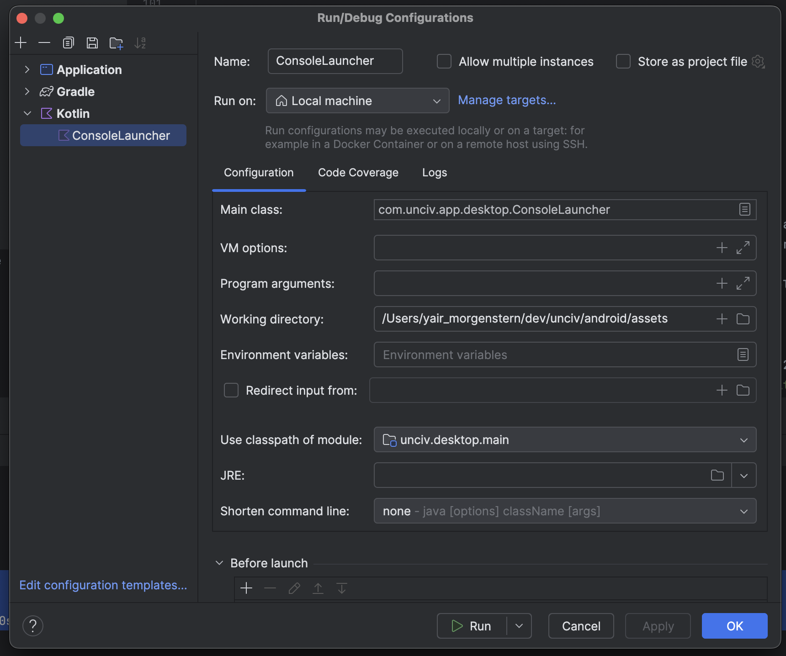

# Simulations

The codebase supports the ability to run automated simulations and compare the results for AI development.

## Enabling

Set up a custom build configuration.

Set the working directory to android/assets, just like when running desktop. And use the `unciv.desktop.main` module.


## Running Sims

Execute the ConsoleLauncher Build Configuration set up above. Results should appear in the Console of the IDE.

## Configuring Sims

Within the `desktop\src\ConsoleLauncher.kt` file, you can adjust the number of sims to run, which nations to use, etc.

Recommend using generic civs with no Uniques. You can see the code add a generic `Nation` to the `ruleset` object, and you can key different behavior throughout the code using the Nation Name constant as the control switch.

You can also adjust the game parameters and map parameters. To get more consistent results, turning off Natural Wonders and Barbarians can help.

By default the order of players is randomized to make it more fair.

The `statTurns` list parameter allows the system to save certain stats at particular turns so you can track it over the course of the games.

## Understanding Results

By default the console will report the number of wins per civ, type of win, and the `popsum` at the end of the game. This is the average amount of population for the whole civ at the end of the game.

It is a good habit to validate your expectations for which Civ would win, how they would win, and any changes in the reported values. Some changes won't show up in the win rates, so are better tested by making a scenario in the Map Editor or with the in-game Console then testing the AI behaviors.

The p-value is also reported, showing based on the winrate how likely this result is in a binomial test. If this value is very small, then there is a low chance this arose out of random chance and that your changes made a statistically significant change in the overall winrate. Running 200-400 Sims is usually a good baseline point.

## AI experiments: new AI against old AI in the same game

`AiExperimentLauncher` compares two versions of the AI inside the same games, which is the only way to see whether a change makes the AI better at fighting and not only at growing.

### How the AI versions are switched

Every switchable piece of AI behaviour is an entry in `AiFeature` (`core/src/com/unciv/logic/automation/AiProfile.kt`), guarded in code like this:

```kotlin
if (civ.aiProfile.has(AiFeature.GreatPersonEscort)) newBehaviour() else oldBehaviour()
```

A civilization's `aiProfile` is a set of features. Profiles are written as specs: `default` (what normal games use), `none`, `all`, plus `+Feature` / `-Feature`, e.g. `default+GreatPersonEscort`.
A new feature starts with `enabledByDefault = false`. Once an experiment shows it is better, flip it to `true`; later, delete the flag and the old branch.

### Running

```
./gradlew :desktop:aiExperiment --args="--candidate=default+GreatPersonEscort --baseline=default --seeds=100"
./gradlew :desktop:aiExperiment --args="--help"
```

- All civs are identical blank nations, so the only difference is the AI profile.
- Each map seed is played twice with sides swapped (start position and turn order), so map luck cancels out.
- `--civs=2` is a duel. `--civs=4` (or 6) plays half the civs with each profile, which guards against an AI tuned only for duels.
- The report (`build/ai-experiment/report.md`) gives the candidate's score (win 1, draw ½, loss 0) with a 95% confidence interval, then cities and population at turns 100 and 200, cities conquered and lost, units killed and lost, survival, and AI time per turn. `games.csv` has one row per civ per game.
- 200 games give about ±7%; small improvements need more.

The **AI experiment** GitHub workflow runs this nightly (all experimental features against `default`, duel and 4 civs) and on demand with your own profiles. The report appears in the run summary and as an artifact.

### Watching a game

Start a new game with yourself as Spectator and the other players as AI, then use the developer console:
`civ aiprofile <civName> default+GreatPersonEscort` switches one civ to another AI profile (without a profile it shows the current one).
The profile is stored in the save file.
